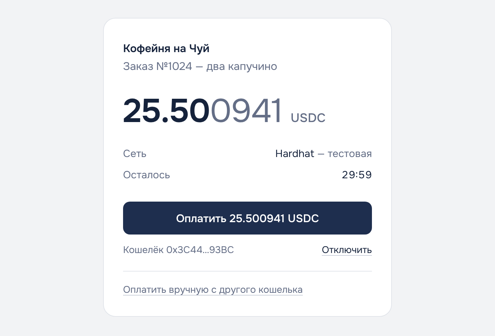
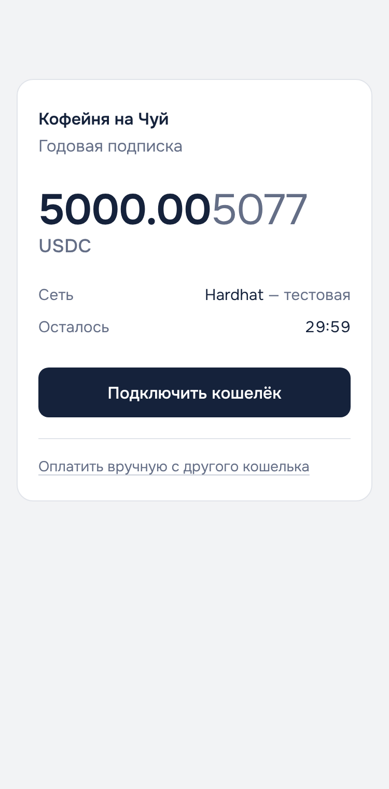
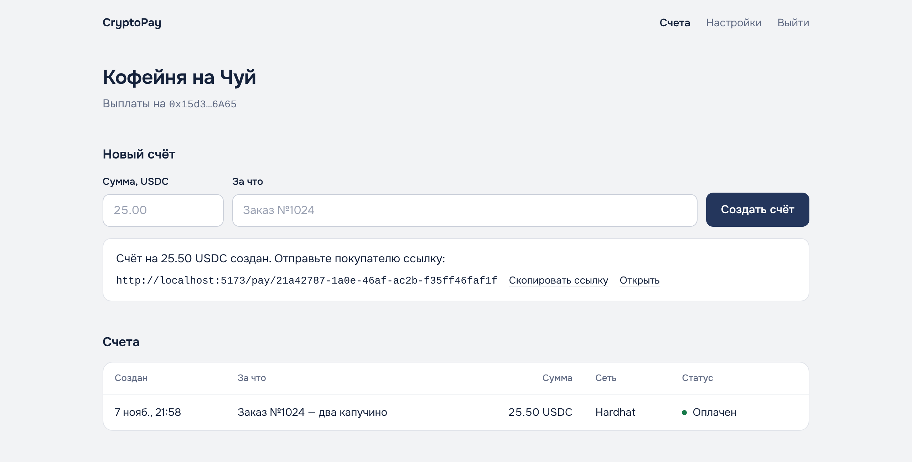

# CryptoPay

Некастодиальная платёжная система для приёма **USDC** через крипто-кошельки **MetaMask**, **Trust Wallet** и **Phantom**.

Магазин выставляет счёт и отправляет покупателю ссылку. Покупатель платит из своего кошелька, деньги приходят прямо на адрес магазина. Сервер следит за блокчейном, ждёт подтверждений и присылает магазину подписанное уведомление. Приватные ключи система не хранит и средствами не распоряжается.

<p>
  
  
</p>


## Как это работает

1. Магазин создаёт счёт на 25.00 USDC в кабинете или через API.
2. Сервер добавляет к сумме уникальный «хвост» меньше цента: покупатель платит `25.004371`. По этой точной сумме сервер однозначно узнаёт, какой счёт оплачен.
3. Покупатель открывает ссылку, подключает кошелёк и нажимает «Оплатить».
4. Сервер находит перевод (по хэшу со страницы или сам, сканируя блокчейн) и ждёт нужное число подтверждений.
5. Счёт становится «Оплачен», магазин получает вебхук `invoice.paid` с HMAC-подписью.

## Возможности

- Оплата в один клик из MetaMask, Trust Wallet, Phantom и 500+ кошельков через Reown AppKit (WalletConnect), включая мобильные по QR-коду.
- Сети Base, Ethereum, Polygon и их тестовые версии. Набор задаётся одной переменной.
- Два независимых пути обнаружения платежа: платёж засчитается, даже если покупатель закрыл страницу или заплатил вручную.
- Защита от двойного зачисления, неподходящих переводов и реорганизаций цепи.
- Вебхуки с подписью, повторами и transactional outbox.
- Кабинет магазина: счета, статусы в реальном времени, настройки, пример API.
- Светлый минималистичный интерфейс, адаптивный до 360 px.
- Запуск на Render из GitHub (`render.yaml`) или на своём сервере одной командой `docker compose up -d --build`.

## Документация

| Документ | Что внутри |
|---|---|
| [docs/TZ.md](docs/TZ.md) | Техническое задание |
| [docs/DIAGRAMS.md](docs/DIAGRAMS.md) | Диаграммы Context, Sequence, Class, State, Activity (PNG в `docs/diagrams/`) |
| [docs/SOLID.md](docs/SOLID.md) | Что такое SOLID и как принципы применены в коде |
| [docs/API.md](docs/API.md) | API для магазина, вебхуки, проверка подписи |
| [docs/DEPLOY-RENDER.md](docs/DEPLOY-RENDER.md) | **Запуск на Render** (бесплатно, без своего сервера) — пошагово |
| [docs/DEPLOY.md](docs/DEPLOY.md) | Запуск на своём сервере (Oracle Cloud, VPS) через Docker Compose |

## Стек

| Часть | Технологии |
|---|---|
| Сервер | Node.js 22, TypeScript, Express 5, PostgreSQL, viem, Zod |
| Клиент | React 19, Vite, wagmi 3, viem, Reown AppKit, TanStack Query |
| Инфраструктура | Docker Compose, Caddy (HTTPS), PostgreSQL 17 |
| Тесты | Vitest |

## Быстрый старт на своём компьютере

Нужны Docker Desktop (или Docker Engine) и Git.

```bash
cp .env.example .env
```

В `.env` для локального запуска поставьте:

```ini
DOMAIN=:80
PUBLIC_URL=http://localhost
POSTGRES_PASSWORD=localpassword123
```

```bash
docker compose up -d --build
```

Откройте [http://localhost](http://localhost). Чтобы в окне выбора кошелька появились QR-код и мобильные кошельки, получите бесплатный Project ID на [dashboard.reown.com](https://dashboard.reown.com) и впишите его в `REOWN_PROJECT_ID`. Без него работают кошельки-расширения браузера.

## Режим разработки

```bash
# 1. PostgreSQL (любым способом), например:
docker run -d --name cryptopay-db -e POSTGRES_PASSWORD=postgres -e POSTGRES_DB=cryptopay -p 5432:5432 postgres:17-alpine

# 2. Сервер: http://localhost:3000
cd server
cp .env.example .env
npm install
npm run dev

# 3. Клиент: http://localhost:5173 (запросы /api проксируются на :3000)
cd web
cp .env.example .env.local   # при желании впишите VITE_REOWN_PROJECT_ID
npm install
npm run dev
```

Проверки:

```bash
cd server && npm test && npm run typecheck
cd web && npm run build
```

## Как проверить оплату в тестовой сети

Тестовые токены бесплатны и ничего не стоят.

1. Установите MetaMask, Trust Wallet или Phantom и создайте **отдельный** тестовый кошелёк.
2. Включите тестовые сети в кошельке. В MetaMask: выбор сети → *Show test networks* → **Base Sepolia**.
3. Получите тестовый ETH на комиссию в сети Base Sepolia (например, через кран Coinbase Developer Platform или любой другой кран Base Sepolia).
4. Получите тестовые USDC на [faucet.circle.com](https://faucet.circle.com): сеть *Base Sepolia*, вставьте свой адрес.
5. В кабинете CryptoPay создайте счёт, откройте ссылку, подключите кошелёк и оплатите.
6. Через 10–20 секунд статус станет «Оплачен». Транзакция видна на [sepolia.basescan.org](https://sepolia.basescan.org).

## Интеграция с магазином

```bash
curl -X POST https://mypay.duckdns.org/api/invoices \
  -H "Authorization: Bearer $CRYPTOPAY_API_KEY" \
  -H "Content-Type: application/json" \
  -d '{"amount": "25.00", "orderId": "1024", "redirectUrl": "https://shop.example/thanks"}'
```

Перенаправьте покупателя на `invoice.paymentUrl` из ответа. Об оплате узнаете из вебхука `invoice.paid`. Обязательно проверяйте его подпись — пример в [docs/API.md](docs/API.md#проверка-подписи).

## Структура

```
cryptopay/
├── docker-compose.yml       PostgreSQL + API/воркер + Caddy
├── .env.example             все настройки с комментариями
├── server/
│   ├── migrations/          SQL-схема, применяется при старте
│   ├── src/
│   │   ├── domain/          счёт, статусы, суммы, подпись вебхука
│   │   ├── ports/           интерфейсы: БД, блокчейн, HTTP
│   │   ├── services/        бизнес-логика платежей
│   │   ├── infrastructure/  PostgreSQL, viem (EVM), отправка вебхуков
│   │   ├── http/            Express: маршруты, валидация, ошибки
│   │   ├── worker/          цикл фоновых задач
│   │   ├── container.ts     сборка зависимостей
│   │   └── index.ts         точка входа
│   └── test/                юнит-тесты и фейки портов
├── web/
│   ├── Caddyfile            HTTPS, статика, прокси /api
│   └── src/
│       ├── pages/           оплата, вход, счета, настройки
│       ├── wallet.tsx       Reown AppKit / кошельки браузера
│       ├── api.ts           клиент API
│       ├── text.ts          все тексты интерфейса
│       └── styles.css       дизайн
└── docs/                    ТЗ, диаграммы, SOLID, API, деплой
```

## Ограничения

- Принимается только USDC в EVM-сетях. Solana (Phantom в режиме Solana) — следующий этап, архитектура к нему готова (`ChainClient`).
- Перевод на сумму, отличную от точной суммы счёта, автоматически не засчитывается. Магазин видит его в своём кошельке и решает вручную.
- Оплата после истечения срока не засчитывается автоматически.
- API-ключ кабинета хранится в `localStorage` браузера мерчанта.

## Перед приёмом настоящих денег

Смотрите чек-лист в [docs/DEPLOY.md](docs/DEPLOY.md#перед-приёмом-настоящих-денег): основные сети, свой RPC, закрытая регистрация, бэкапы и юридическая сторона приёма криптовалюты.
