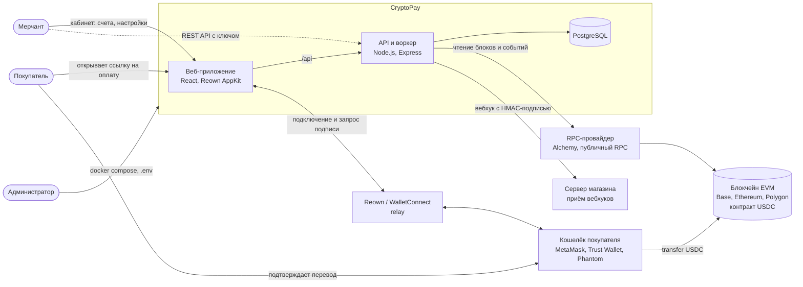
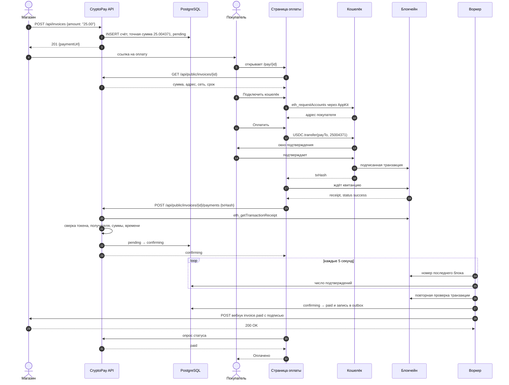
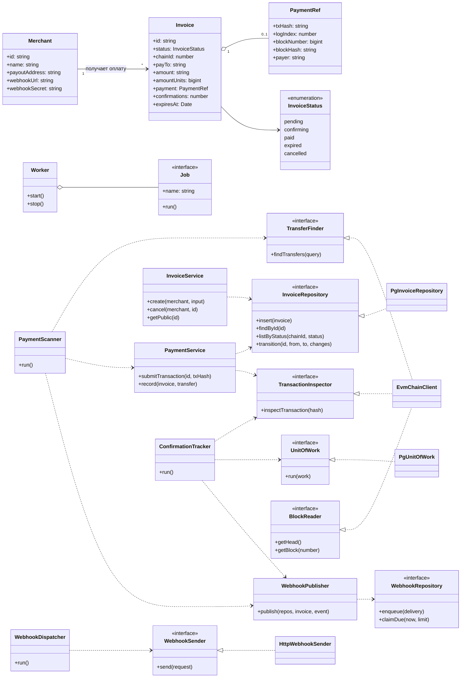
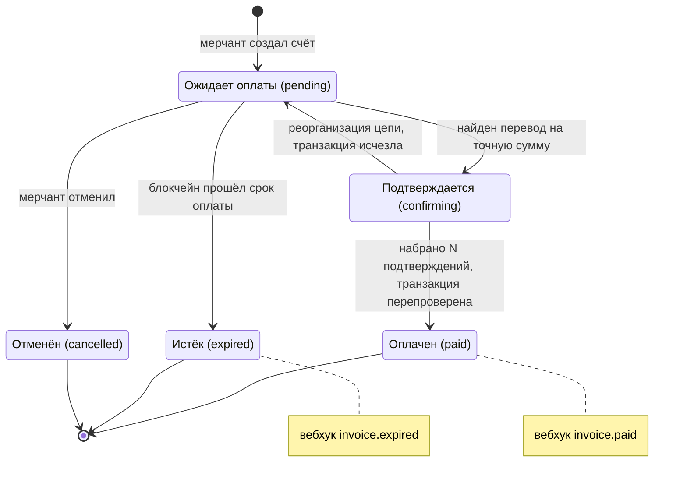
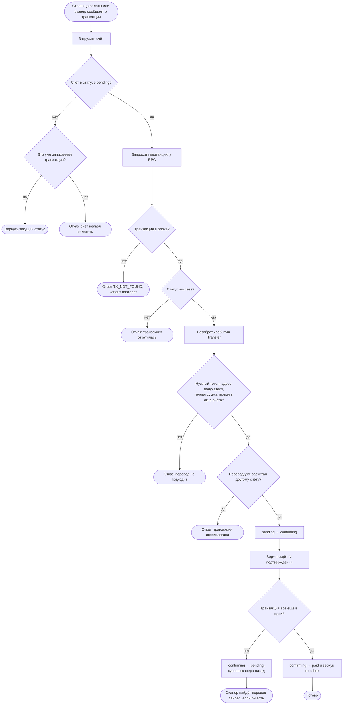

# Диаграммы CryptoPay

Пять диаграмм описывают систему с разных сторон. Все они написаны на Mermaid: GitHub и GitLab показывают их прямо в этом файле, а для правки удобен [Mermaid Live](https://mermaid.live) или Mermaid Chart (ссылки «Открыть в Mermaid Chart» под каждой диаграммой). PNG-версии для отчёта или презентации лежат в [`diagrams/`](diagrams).

| Диаграмма | Отвечает на вопрос |
|---|---|
| [Context](#1-context--система-и-её-окружение) | С кем и с чем взаимодействует система |
| [Sequence](#2-sequence--оплата-счёта-шаг-за-шагом) | Что происходит по шагам, когда покупатель платит |
| [Class](#3-class--устройство-кода) | Из каких классов и интерфейсов состоит сервер |
| [State](#4-state--жизненный-цикл-счёта) | Какие статусы бывают у счёта и как они меняются |
| [Activity](#5-activity--проверка-платежа) | Как сервер решает, засчитать ли транзакцию |

## 1. Context — система и её окружение

Система некастодиальная: деньги идут из кошелька покупателя прямо на адрес мерчанта. CryptoPay только читает блокчейн и никогда не хранит приватные ключи.

[Открыть в Mermaid Chart](https://mermaid.ai/app/plugin/save?state=pako%3AeNptVNFOGlEQ_ZUbnjRBfTfGhFKTNpWGom0ftj4sy1WosLvZXUtJtwliGptobO1j06TpH4CFiiDwC3P_qGdmVyS1Dyy7d2bOnDlzdj9kHK-iM-uZ_brXdKp2EKnt0htXKecojLyGDpYs-klTGpkTmlHXdGhAY3O-t8w5CKPEjZDzgwambU6pSxPTSaJ2pVFzEfpKfbqlIU1oaI5Nx7QFZmranMaJ4VH5ILD9qnKClh95vt1SVl5ui3ZrjzOUauqyRd_QvLdCM0AMaQxWf3AAWBpslIO1zZK2nSirStpruirn-89qUVpt-zUrV3yqaKjoilvTiPlK1XPMv_o2zKqt936gwzAtqZStpaIXRgeB3nmxvSyn2q0kjJt2va4ji74D67MockkjBYH-FeqLtCjoyC7Y4WFW7QaQVb2W8qwqsnheQ7ADXbdbVsJ9Lc3Ie66rnUgwJJ5k-o5VKuYTHaaYp0s3kPhunlzdqepGKws6oNKDTkPsZWLO6EahTCCwtZprLdGlqDhCfACMidp6VRCMR3aoIUhU1YE-aoCoV28deK7EIN2Ul8x7RGlHvdx5nE_0Caueb9EvpgJauCosvku_8bsWA3QTBFkgJLvlbWCl5hOYMuzVXqLvnfnUyspmDI07aNTGBDzrAC3ho2M8jlltxbgKxTM8Q3dzErNbFv2ZwIxQ3BMagFhnjFO-o25WIFJvTiHEiIb_wVgFSGlrZ1exk8yxQtrYXABkSrcxW0ycocvSbQ3P80P88SE8dZeyIYzYL_05TGplMek1uMp6uU-SNuPXh4mJE-aWEajUkA-lk1LMKNvA69JPBUSADwb8NlA_XqhP7qQ6Cmw33AcUbzhOTLMwTmxOxeUp617iJd4ijwCuU2z2DClDuonZtal5RYoHYItOYHWfFHJs8fvRzbm5iMVi84-LFFY85xAcHa_he-zaVe2-i-8_JZmPfwEIsmyh&utm_source=mermaid_app_widget&utm_medium=claude-app-v1) · [PNG](diagrams/1-context.png)

## 2. Sequence — оплата счёта шаг за шагом

Если покупатель закроет вкладку сразу после отправки (шаги 19–23 не произойдут), воркер всё равно найдёт перевод: он просматривает события `Transfer` на адрес мерчанта и узнаёт счёт по точной сумме.

[Открыть в Mermaid Chart](https://mermaid.ai/app/plugin/save?state=pako%3AeNp1VO1KG1EQfZUhv1pITbSVwv4QTCKtpGlTE_FPoKybNS6Y3e3u3aKIkA-qhYiiP0tp6RvENKkxMfEV7n2FPkln7t3NVy0hH3tz5szMmTP3OGY4ZTOmxXzzY2Dahpmx9IqnV0s2gB4wxw6qu6YnnwzmeJAD3Qf-jbf5L3zf8j4f0Z-u7jHLsFzdZrCe3yRQ2jtymZPXj-hgEZNJESTv-KzimYX3b6YJ0jLBDz7mA9HkD7wtGrzHh-J8kSIvgT9FQ9SwkhHvi1PeBox74EOKEq3FiKyM-MrH4oukvOKDRYgsi18hA-U_Q9jdvw3uKKJrJKrxAe-JWskmTO7Z2hr2qkH-XaEICd21Epb9ybEM04djveoENtOgFFtZXUomS7ETCkE4BmVSGmy-LWxsFUHUxZm4Eo04YN9jrGCEvVzScZPf46sNMvzF85fLcXBNu2zZlYgImXIarCSX4djVj6qmzba9g5OosrRGLHXRwuYGpNRoXq4mAdMIzGt4jNkHoobgDorbEw1IIGXi2CpLvnzU6auNsFE32D2wjEm_E2RYV16baSEOyNlF7Xqijn3WiV-c0y88G6uhRIWQEbpY71BcoBh9AgI-LoyQ6slqYLL9Dx752GfrhkF6-0BDpFT8FtZdN2sxwmfDmqZ1AOqwaLnL2UK-R0KpImaybhcy6SXm6ba_Z3pPUKaiE8cpqSE9Vemk_JQAVR-rXF2k6sjafmOHPengSUakfQQkJxERpiIIfvZRRNqB0CzRStzi5wDXIiSOumaHr3V_P-qAeJCcTEfKdqg_ipZxF4RKhXGeaZiWy-LgM50FPviBgaP25wwxtf5jjkiEvsR9UEXMLEFKza9isiJpibeB5dhbKuUUJZNgt0oU8jHtCW0hNR9XkgxFE8c-GWN84j3RQkRH2uFeST6_hOFCwZ_TazAce8_yqvP7hSrMnx84jkuytaWGLd6DVeloaaUR7xIG8MYIhcbpU2ZRk4UicIjQLh738D5FY9yom4e3Z-KoMOl9Qv_fPPyOYrAB-tqZdUhHXiW10B38QW7ZrICLdlGyTJJPO5bCuLpVBt4HiZfeo53sgBOwXedwEpkLzUCZ-I34jHoMIHTDkuSItq4bsSi75UjonSzdZEl4l52zF91XVD6GYkBDXVxk_vkZEb2KCzcv2t4zqdU4dvIXq15a5A&utm_source=mermaid_app_widget&utm_medium=claude-app-v1) · [PNG](diagrams/2-sequence.png)

## 3. Class — устройство кода

Сервисы зависят только от интерфейсов (`<<interface>>`). Конкретные классы `Pg*`, `EvmChainClient` и `HttpWebhookSender` подключаются в одном месте, `server/src/container.ts`. Подробно об этом в [SOLID.md](SOLID.md).

[Открыть в Mermaid Chart](https://mermaid.ai/app/plugin/save?state=pako%3AeNqVVUtu2zAQvQrhldI4Rrs1AgP5tIiLfgI7QTbZ0NLYJiKRKkk5MdJskkWvk01XAZor2DfqUBQtSpbidkfOPM7_De87oYig0--EMVXqlNGZpMk1JyRiEkLNBCdfRtfcSHIEGfKFYCGQeyMiZJ9FfaK0ZHxWCJSmOlN9Bxzn10IXzinjQ3zBs2QCspCmdHkhalZoIjKuG4WXnGm0P2EzxnVpIgGDP7eHEUydS8GnTCbUpKJqjuEuxSzVEb47pRqM9KHMtDS1SVbfnVE1r0UVi9mQR3BXMz6JRXjzLZfUgs01DYYwCYMtZV4wX0Fi8bhurzunCWwbFJk-iiJMUtV0tzCZC3FzKeNmxRhCCbolmkpvXUiHh4AFAJmXejCwwhR4tLFd9GJzTymL7Ml2oriElIcQx_b60DB8I0iFYlrIZekbywtySkNwnvcZVyB1wOybvUI6ZTw6Xg6jgEVOFDOlj5c2maAY0S6xc-wwWlKOLjEzfNglUymSLtGiS0xXZmBxXoWubBX_LVLgPzLIIIggZguQS-cUTbHkFBVc3HZJzBKm634MGb5Pr4S8ecuBzHhwi5j66wuTFc1pPuQqRcILuaOkBuQ9C-Y4x41mpyA_Ya3hTYOmGw6tAqxCkbxn7NiwZQR0h6UZ6DMEBXvlPX8ZWFK29GcMuyJUiAgkYGhqq_ifxeStpw2MNI3YaxvrMciFv1qRgLiVgqSgfpcwnmZ6Mxw5S3xt5OV-nk1iFroh395qdV8qm-B0-Y01Y273nTOLH4KQkSMUaovGtbnACHlZ3EruDnribWd0Ht7swBdty7NTcw-cWgl2CglnKlXECAuMpMXKKVMp1eF8l08kjgfBvYBbZW9zE2lDR89nW6vKV5asLaUfF8mJ2T0nMQP7VVj5mdZpZVqtn82HcN35cN0hBwcDPL3Dk_ug-2T1uvqzelk_rX-tnle_148Er6-rl9Xz-nH9ZGw4qDUhDg7w9L7XM5fqP-qAxkvtX_fU3rI7_NnrtRXBW1kFrFqOxqWUI7dLVNs0LSh_hbRAqvsgB7UUvkbWXm9AGtOsEe1_cE0V8KEFsTbQTQFaQFUXLaA6tQysiZ5vBdiGrza4DdUUwRbhPWC1jtuk9qCugcSx2Qw7ru_Ow1-yfctZ&utm_source=mermaid_app_widget&utm_medium=claude-app-v1) · [PNG](diagrams/3-class.png)

## 4. State — жизненный цикл счёта

Таблица переходов в коде — `server/src/domain/invoice.ts`. Любой другой переход запрещён и возвращает ошибку `INVALID_STATE`.

[Открыть в Mermaid Chart](https://mermaid.ai/app/plugin/save?state=pako%3AeNp1ks1OwlAQhV9l0hUaceGShSvXvoC4aErBJtIaJMbEmECJYmKicedKXwF_kPJXX2HmjTxzvW0p4qZwf843c87cK8eLGr5Tc867btc_CNxWx21XL_bqIZHZorrDL_zFCX_yiMcSE6f8zXMeSSz3VDnzw0YQtrbqDrnnZFcl9SsEnxLzO9Q9kCxH-vJIFS8Km0GnXRCKjbUWfmsOecxLVHWDRlYSf0tXn0GO5YlnVPEvz4KOn920qzIXjS2UCQG4nht6_ulpLsnX9VBlR9vHVK3uZzapRiqWHtoaARGT9GF2YizOsZChPEmsykyh6sKiApa4O4VCfcGkZjRGVsjMnBEaTMFfykAeFDlAyYUM1qHWnBLfkFTKM5PV1FDBTOUOFk1TPT0tjfFPh5ntvw4BsonhScxVuGLHZIN5ZL7eUAsyTulQva2_g1_IdAce7cUJvjO55QRvIw_DtG9lKhltqppPxFxK8f0wxESZlogf0Dj5r2CiE8OVieZiMlEvisfgdZ2FvLJVRJVv6nYY4X11gtZJl6Jmngk8IJMbzHBGQXgRBZ6_m73fsmJlnJtE9ti5_gERWeUx&utm_source=mermaid_app_widget&utm_medium=claude-app-v1) · [PNG](diagrams/4-state.png)

## 5. Activity — проверка платежа

[Открыть в Mermaid Chart](https://mermaid.ai/app/plugin/save?state=pako%3AeNqNVdtKG1EU_ZVDnioofZdiHyp9VCkpFNIg4-SoQ-OMzEyqJQjJBBUxNKgPferFvhdiTJoYneQXzvmFfknX3mdmctFCCSQzJ3uvWWvty1RztleSueXcdtk7sHctPxT51feuEEGI62cFda0jXVNtFauBPlFtoUZqrO5VG8fnQg1wORC6roYc0tM1uhnhc6PPcNTTETJEhtHH9xA4AzUoLoilpRVR9qxSQX3B-a2u6QYiBohuAkaf6gsdFYkMBXG0E2xIt-S4O1UQ4_-F6lBsxIwaeHhP7JuQl0eUmmUgXzDFiJECa0_mD6vqF1JBsKF-I5P5jcGgzmxjgLaeIK9bBttgMHAX1hCsXfF96ZJxl-SGisGJ5USqh-QGXBmouxnGxYU5rAlJ1ws3rE_WVlkC8BtSyOb-cmYOx6p73VR9EJ2UxnhogGcNSHn60pbOfmicH4PoCJqN83hIhy5JM6v9DHvEm41XXIokkUH2HFeWqurnY3-oKuoGZEZA6xm3OHpOYNkKpZ9o6_Bp_t3m2np-8_X627XVReKCBoPGmMSOAdeheuGBIGj0TWBTbUHFtmUQUItkJqeHSeHMzRwZX36UfihLc15HT8kbmQCymi2vp3ZPQ6eESpKGrKB-ECLPRo15Nc2w3OhzLllL5H3LDbalz06bLGO0Fdq7VfWV2zTW59RBkfFWxXCprbqA7EEme3QPxadMjpqjtfhiy3--wr6dpj1dB9QDPm1kdyhXPSRVI1R4kvWYaiflIw5zju05AR_POgYOPYbsAKzL8YZXVx_T91TtMszUqkpAHfV9BmBqOIlU2puCROO_WwQ9oENTwrphCBPUDHZofZDu_xSX5t_42OR6dTikbThnsBMbbM_ddnw04k4h2T3iz8nl1DHXc3LLSQeWE9KWoGYe8uaEyi5P9VpqlxmKGv1BlabVwVCUa1o9dMrlf00gDLkQyD-jH2zJE2BguSUjQJlPDkBhiijJSCSZLuIdVqO2Nas-2_v0aoi5v9GMyaYgtAQ4sC2y_nrqRcHhd4nk-Z7pcxhZP1okDXV-0eAg5rvJepvoSMu8bzmlRxpwJggAfmLejtE2Q_LEq4Rb3iHT5RCeVs-ldXvFM84Migu5o78sQeOG&utm_source=mermaid_app_widget&utm_medium=claude-app-v1) · [PNG](diagrams/5-activity.png)
